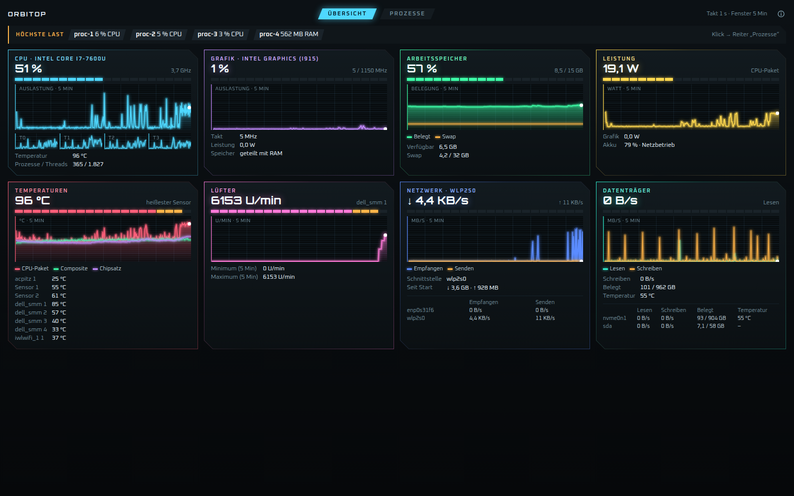
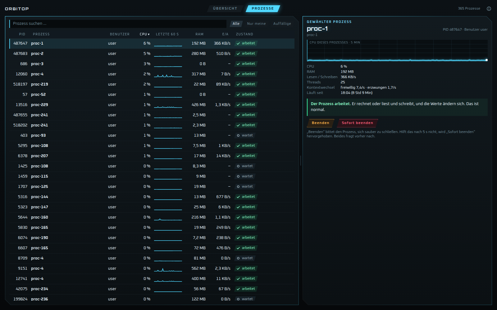

# orbitop

[English](README.md)

Ein Systemmonitor für Linux, der zeigt, was der Rechner unter Last tut und warum.

## Was orbitop ist und wofür

orbitop zeigt CPU, GPU, Arbeitsspeicher, Leistung, Temperaturen, Lüfter, Netzwerk und Datenträger als laufende Verläufe der letzten 5 Minuten. Die Prozessliste sagt, welcher Prozess die Last verursacht und ob er arbeitet, wartet, ohne Lebenszeichen rechnet oder im Kernel hängt. Hängt ein Prozess, lässt er sich aus der Liste beenden, immer erst nach einer Rückfrage.

orbitop ist ein GTK-4-Fenster mit einer WebKitGTK-6.0-Ansicht, geschrieben in Python, nur mit der Standardbibliothek und PyGObject. Es läuft auf jeder Hardware: Ein fehlender Sensor erscheint als „nicht vorhanden“ und führt zu keinem Fehler. Die Oberfläche gibt es auf Deutsch und Englisch, sie folgt der Systemsprache.

**Stand:** Version 0.1.0. orbitop läuft aus dem entpackten Release-Archiv oder aus einem Checkout dieses Repositorys. Ein `.deb`-, `.rpm`-, AUR- oder Flatpak-Paket und einen Update-Kanal gibt es noch nicht.

## Funktionen

### Reiter „Übersicht“

- Je eine Kachel für CPU, jede GPU, Arbeitsspeicher, Leistung, Temperaturen, Lüfter, Netzwerk und Datenträger, mit einem Verlauf der letzten 5 Minuten, ein Wert je Sekunde. Die CPU-Kachel hat zusätzlich einen kleinen Verlauf je Thread.
- Eine Leiste oben nennt die drei Prozesse mit der höchsten CPU-Last und den mit dem meisten RAM. Ein Klick darauf öffnet den Prozess-Reiter.
- Sensoren, die der Rechner nicht hat, stehen unten unter „Nicht vorhanden“.

### Reiter „Prozesse“

- Spalten PID, Prozess, Benutzer, CPU, Letzte 60 s, RAM, E/A und Zustand. Die `top`-Spalten PR, NI, VIRT, SHR, S, %MEM und TIME+ gibt es auch, sie sind anfangs ausgeblendet.
- Ein Rechtsklick auf einen Spaltenkopf öffnet das Spaltenmenü: Spalten ein- und ausblenden, eine Spalte nach links oder rechts verschieben, den Standard wiederherstellen. Per Tastatur öffnet die Menütaste oder Umschalt+F10 auf einem Kopf dasselbe Menü.
- Einen Kopf ziehen verschiebt die Spalte, seinen rechten Rand ziehen ändert die Breite (per Tastatur Alt+Links und Alt+Rechts). Sind die Spalten breiter als die Liste, scrollt die Liste waagerecht.
- Der Trenner zwischen Liste und Detailbereich lässt sich ziehen oder mit den Pfeiltasten verschieben.
- Reihenfolge, ausgeblendete Spalten, Breiten und die Position des Trenners stehen in `~/.config/orbitop/layout.json` (unter `$XDG_CONFIG_HOME`, wenn das gesetzt ist) und überstehen einen Neustart.
- Suche in Namen und Argumenten, Filter „Alle“, „Nur meine“ und „Auffällige“ (jeder Zustand außer „arbeitet“ und „wartet“). Ein Klick auf einen Kopf sortiert nach dieser Spalte.
- Der Detailbereich zeigt zum gewählten Prozess die Befehlszeile, den CPU-Verlauf der letzten 5 Minuten, RAM, Lese- und Schreibrate, Threads, Kontextwechsel und Startzeit, bei Zombies dazu den Elternprozess.

### Die Zustände sind ein Hinweis, kein Urteil

Der Prozess-Reiter stuft jeden Prozess ein: arbeitet, wartet, Dauerlast, angehalten, Zombie, hängt im Kernel. Das ist eine Heuristik aus `/proc`, und orbitop sagt das auch. „Dauerlast, keine E/A“ heißt: mindestens 90 % eines Kerns über zwei Minuten, höchstens ein freiwilliger Kontextwechsel je Sekunde und keine E/A-Bytes. Von außen sieht das genauso aus wie eine lange Rechnung. „Hängt im Kernel“ heißt: Zustand D länger als 10 s ohne Fortschritt (keine CPU-Zeit und keine E/A dazwischen). Selbst „Sofort beenden“ wirkt erst, wenn der Kernel einen solchen Prozess freigibt.

### Prozesse beenden

- „Beenden“ schickt SIGTERM und sieht 5 s später nach, ob der Prozess noch läuft. Läuft er noch, wird „Sofort beenden“ (SIGKILL) hervorgehoben. Beides fragt vorher nach.
- Unmittelbar vor dem Signal prüft orbitop PID und Startzeit erneut. So trifft eine neu vergebene PID nie einen anderen Prozess.
- Eigene Prozesse bekommen das Signal direkt. Prozesse anderer Benutzer beendet orbitop nur über `pkexec` und den root-eigenen Helfer, den `setup-privileges.sh` installiert. PID 1 und Kernel-Threads lassen sich nicht beenden.

Das Schließen des Fensters blendet es nur aus. orbitop liest die Prozessliste im Hintergrund weiter, damit die Zustände beim nächsten Öffnen schon feststehen. Strg+Q oder „orbitop beenden“ im Dialog „Über“ beendet es.

## Screenshots





Beide Bilder zeigen Demodaten aus `tests/ui/demo.html`, kein laufendes System. Prozessnamen, Befehlszeilen und Benutzer sind anonymisiert; die Hardwarenamen (CPU, Schnittstellen, Datenträger, Sensoren) stammen vom Referenzlaptop. Die Demoseite zeigt die deutsche Oberfläche.

## Tech-Stack-Analyse

### Sprache und Bibliotheken

- Python 3.12 oder neuer, nur die Standardbibliothek, dazu PyGObject für GTK 4 und WebKitGTK 6.0. Kein psutil: orbitop liest `/proc` und `/sys` selbst.
- Die Oberfläche besteht aus HTML, CSS und reinem JavaScript in `orbitop/ui/`, ohne Frameworks. `chart.js` zeichnet die Verläufe auf ein Canvas.
- Die Schriften Orbitron und Oxanium liegen bei. Alle sichtbaren Texte stammen aus `orbitop/locale/en.json` und `orbitop/locale/de.json`.

### Oberfläche

- Ein GTK-4-Fenster enthält eine einzige WebKitGTK-6.0-Ansicht. Die Seite lädt über das eigene URI-Schema `orbitop://ui/`, nie über `file://`. Der Schema-Handler liefert nur reguläre Dateien bekannten Typs unterhalb von `orbitop/ui/`.
- Content Security Policy: `default-src 'none'`, Skripte, Stile und Schriften nur von der Seite selbst, `connect-src 'none'`. Die Seite hat keinen Netzzugriff.
- Die Ansicht nutzt eine flüchtige Netzwerksitzung und legt nichts auf der Platte ab. Sie navigiert nur zu orbitops eigenen Seiten; neue Fenster und Downloads werden abgelehnt.
- Solange das Fenster sichtbar ist, schickt Python jede Sekunde einen JSON-Schnappschuss an `window.orbitop.receive`. Python schickt Basiseinheiten, die Seite formatiert sie mit `Intl.NumberFormat`.

### Datenquellen

- `/proc`: `stat`, `meminfo`, `cpuinfo`, `diskstats`, `net/dev`, `mounts` und je Prozess `stat`, `status`, `statm`, `io` und `cmdline`.
- `/sys`: CPU-Takt, Blockgeräte, Netzwerkschnittstellen, Thermalzonen, Akkus, `devfreq` und die DRM-Karten (GPU-Last, Takt, Grafikspeicher).
- hwmon (`/sys/class/hwmon`): Temperaturen, Lüfter und Leistungswerte.
- powercap (`/sys/class/powercap/intel-rapl:*`): Leistung des CPU-Pakets aus den RAPL-Energiezählern, wenn sie lesbar sind.
- DRM-fdinfo (`/proc/<pid>/fdinfo`): GPU-Nutzung der eigenen Prozesse.
- `intel_gpu_top` (optional): Intel-GPU-Last aller Prozesse und die Paketleistung.
- `nvidia-smi` (optional): Last, Speicher, Temperatur, Leistung und Takt von NVIDIA-GPUs.

### Threads und Takte

- `orbitop-worker`: liest die Systemwerte jede Sekunde und baut den Schnappschuss.
- `orbitop-procs`: liest die Prozessliste alle 2 s, auch bei ausgeblendetem Fenster. Das Lesen von `/proc/<pid>/cmdline` kann blockieren (etwa bei einem hängenden FUSE- oder NFS-Mount); dann wartet nur die Prozessliste, die Kacheln laufen weiter.
- Werkzeuge: `intel_gpu_top` und `nvidia-smi` laufen als langlebige Kindprozesse, jedes von einem eigenen Thread gelesen. `intel_gpu_top` meldet alle 2 s, `nvidia-smi` jede Sekunde.
- Langsame hwmon-Chips (`dell_smm`, dort ist jeder Lesezugriff ein BIOS-Aufruf) liest orbitop höchstens alle 5 s.
- `/proc/<pid>/status` (Eigentümer, Kontextwechsel) liest orbitop je Prozess alle 10 s. Den gewählten Prozess und Prozesse ab 90 % eines Kerns liest es in jedem Prozess-Takt.
- Der GTK-Hauptthread bedient nur Fenster und Ansicht; der Worker übergibt das fertige JSON über `GLib.idle_add`.

### Sicherheitsmodell

- Die Seite spricht mit Python nur über `parse_message` in `orbitop/app.py`. Die Schleuse nimmt die Nachrichten `ready`, `view`, `layout`, `terminate` und `quit` an, prüft jeden Wert auf Typ und Wertebereich, verwirft unbekannte Schlüssel und begrenzt die Größe auf 4096 Zeichen. Alles andere wird verworfen.
- Prozessnamen, Befehlszeilen und Benutzer kommen nur als Text (`textContent`) in die Seite, nie als HTML.
- orbitop öffnet keinen Port und baut keine Netzwerkverbindung auf.
- Einen Prozess eines anderen Benutzers beendet orbitop mit `pkexec /usr/bin/python3 -I /usr/local/libexec/orbitop/killhelper.py`. Vorher prüft es per `lstat`, dass der Helfer eine reguläre Datei und kein Symlink ist und dass er und jedes Verzeichnis bis `/` root gehören und für Gruppe und andere nicht beschreibbar sind. Sonst zeigt es einen Hinweis und fragt nach keinem Passwort.
- Der Helfer öffnet ein pidfd, bevor er PID und Startzeit prüft. So erreicht das Signal genau den geprüften Prozess. PID 1 und Kernel-Threads lehnt er ab.
- `intel_gpu_top` und `nvidia-smi` startet orbitop mit Argumentlisten, nie über eine Shell, und nur aus dem festen Pfad `/usr/local/bin:/usr/bin:/bin`.

### Tests

- pytest. Jeder Leser nimmt ein Argument `root`, deshalb laufen die Tests gegen nachgebaute `/proc`- und `/sys`-Bäume in `tests/fixtures/roots/`: `intel-laptop` (auf dem Referenzlaptop aufgenommen), `amd-desktop`, `arm-board` und `vm`.
- `tests/ui/check.html` prüft die Seite im kopflosen Chrome bei zwei Fenstergrößen. Ohne Chrome oder Chromium überspringen sich diese Tests.
- Die Testsuite ruft auch ShellCheck, `desktop-file-validate` und `appstreamcli` auf und braucht deshalb pytest, ShellCheck, desktop-file-utils und AppStream.
- `scripts/check-distros.sh` führt das Setup und die Testsuite in wegwerfbaren Docker-Containern aus, einer je Distribution. Die Ergebnisse stehen in [`docs/distro-check.md`](docs/distro-check.md).

```sh
python3 -m pytest -q
```

### Architektur

```text
/proc  /sys  intel_gpu_top  nvidia-smi
   |
   v
sysfs.py  system.py  sensors.py  gpu.py  gpu_tools.py  procs.py  classify.py
   |
   v
sampler.py          rates, histories, JSON snapshot
   |  app.py Worker: threads orbitop-worker (1 s), orbitop-procs (2 s)
   v
shell.py            GTK 4 window, WebKitGTK 6.0 view, orbitop://ui/
   |  window.orbitop.receive(msg)
   v
orbitop/ui/app.js   page, chart.js draws the charts
   |  postMessage: ready, view, layout, terminate, quit
   v
app.py parse_message
   |-- layout    -> layout.py  -> ~/.config/orbitop/layout.json
   '-- terminate -> actions.py -> own process: signal
                               -> other user: pkexec killhelper.py
```

## Voraussetzungen

- Linux mit Python 3.12 oder neuer
- PyGObject, GTK 4 und WebKitGTK 6.0, jeweils mit der Typelib für GObject Introspection (`Gtk-4.0`, `WebKit-6.0`)
- Optional: `intel_gpu_top` aus den Intel-GPU-Werkzeugen, für die Intel-GPU-Last aller Prozesse und die Paketleistung (mit `--allow-perfmon`, siehe [Rechte und Risiken](#rechte-und-risiken))
- Optional: `nvidia-smi` für NVIDIA-GPUs. Es kommt mit dem proprietären Treiber, etwa in `nvidia-utils-<version>`.

Beim Start prüft orbitop die Python-Version, PyGObject, GTK 4 und WebKitGTK 6.0. Fehlt etwas, nennt es das Paket der laufenden Distribution und den Befehl zum Installieren; bei einer unbekannten Distribution nimmt es die Debian-Namen.

### Unterstützte Distributionen

<!-- supported:start -->
| Geprüfte Distribution | Davon abgeleitet, nicht eigens geprüft |
|---|---|
| Ubuntu 26.04 | |
| Ubuntu 24.04 | Linux Mint 22, Pop!_OS 24.04 |
| Debian 13 | |
| Fedora 45 | |
| Arch Linux | Manjaro, EndeavourOS |
| openSUSE Tumbleweed | |
<!-- supported:end -->

Geprüft am 2026-11-18 mit `scripts/check-distros.sh` in wegwerfbaren Docker-Containern: Setup, Import von GTK 4 und WebKitGTK 6.0, Testsuite, Probelauf. Die Container haben keinen Bildschirm, deshalb gehörten das Fenster selbst, der Helfer über `pkexec` und die Optionen `--allow-*` nicht zur Prüfung. Einzelheiten stehen in [`docs/distro-check.md`](docs/distro-check.md).

Nicht unterstützt: Debian 12 (Python 3.11) und Ubuntu 22.04 (Python 3.10). Beide liefern WebKitGTK 6.0, und das Setup läuft durch, aber orbitop braucht Python 3.12 oder neuer und startet dort nicht.

### Paketnamen

| Distribution | Paketmanager | Laufzeitpakete | Intel-GPU-Werkzeuge |
|---|---|---|---|
| Debian, Ubuntu | `apt-get` | `python3-gi` `gir1.2-gtk-4.0` `gir1.2-webkit-6.0` | `intel-gpu-tools` |
| Fedora | `dnf` | `python3-gobject` `gtk4` `webkitgtk6.0` | `igt-gpu-tools` |
| Arch Linux | `pacman` | `python-gobject` `gtk4` `webkitgtk-6.0` | `intel-gpu-tools` |
| openSUSE | `zypper` | `python3-gobject` `typelib-1_0-Gtk-4_0` `typelib-1_0-WebKit-6_0` `python3-gobject-Gdk` | `igt-gpu-tools` |

`setup-privileges.sh` installiert diese Pakete mit dem Paketmanager, den es findet. Die Intel-GPU-Werkzeuge kommen nur dazu, wenn der Rechner eine Intel-GPU hat (Treiber `i915` oder `xe`).

## Installation

### orbitop holen

Aus dem Release:

```sh
mkdir -p ~/.local/opt
cd ~/.local/opt
curl -LO https://github.com/zappelmann-sketch/orbitop/releases/download/v0.1.0/orbitop-0.1.0.tar.gz
curl -LO https://github.com/zappelmann-sketch/orbitop/releases/download/v0.1.0/SHA256SUMS
sha256sum -c SHA256SUMS
tar -xzf orbitop-0.1.0.tar.gz
cd orbitop-0.1.0
```

`sha256sum -c` muss `orbitop-0.1.0.tar.gz: OK` ausgeben. Entpacken Sie orbitop an einen dauerhaften Ort wie `~/.local/opt`: `install-user.sh` trägt den Pfad dieses Verzeichnisses in den Starter und den Autostart-Eintrag ein. Verschieben oder löschen Sie das Verzeichnis danach nicht.

Oder mit git:

```sh
git clone https://github.com/zappelmann-sketch/orbitop.git
cd orbitop
```

Danach in diesem Verzeichnis die Befehle Ihrer Distribution ausführen. Was das Setup tun würde, zeigt vorher `bash scripts/setup-privileges.sh --dry-run`; das braucht kein root und ändert nichts.

### Ubuntu und Debian

```sh
sudo apt-get update
sudo bash scripts/setup-privileges.sh
bash scripts/install-user.sh
```

### Fedora und openSUSE

```sh
sudo bash scripts/setup-privileges.sh
bash scripts/install-user.sh
```

`dnf` und `zypper` frischen ihren Paketindex selbst auf.

### Arch Linux

```sh
sudo pacman -Syu
sudo bash scripts/setup-privileges.sh
bash scripts/install-user.sh
```

Abgeleitete Distributionen wie Linux Mint, Pop!_OS, Manjaro oder EndeavourOS nehmen die Befehle ihrer Basis.

### Andere Distributionen

Findet `setup-privileges.sh` keinen der Paketmanager `apt-get`, `dnf`, `pacman` und `zypper`, meldet es „No supported package manager found“ und installiert keine Pakete. Installieren Sie dann selbst mit dem Paketmanager Ihrer Distribution:

- Python 3.12 oder neuer
- PyGObject
- GTK 4 mit der Typelib `Gtk-4.0`
- WebKitGTK 6.0 mit der Typelib `WebKit-6.0`
- optional: `intel_gpu_top` (Intel-GPU-Werkzeuge) und `nvidia-smi`

Danach wie oben `sudo bash scripts/setup-privileges.sh` und `bash scripts/install-user.sh` ausführen. Den root-eigenen Helfer installiert das Setup-Skript trotzdem. Auf einer solchen Distribution ist orbitop nicht geprüft.

### Start

orbitop startet aus dem Anwendungsmenü oder mit `bin/orbitop`. Ab der nächsten Anmeldung startet der Autostart-Eintrag es ausgeblendet (`--hidden`); ein erneuter Start aus dem Menü zeigt das Fenster.

## Rechte und Risiken

- `scripts/setup-privileges.sh` (mit `sudo`) installiert die Laufzeitpakete Ihrer Distribution und, wenn eine Intel-GPU (`i915` oder `xe`) vorhanden ist, die Intel-GPU-Werkzeuge. Auf jedem Rechner kopiert es `orbitop/killhelper.py` root-eigen nach `/usr/local/libexec/orbitop/killhelper.py`; ohne diese Kopie lassen sich Prozesse anderer Benutzer nicht beenden. Nach einem Update von `orbitop/killhelper.py` (etwa nach `git pull` oder einem neuen Release) das Skript erneut ausführen. Nur mit `--allow-perfmon` gibt es `intel_gpu_top` die Datei-Fähigkeit `cap_perfmon`, damit es ohne root läuft (siehe die Risiken unten). Ein Update des Pakets mit den Intel-GPU-Werkzeugen entfernt die Fähigkeit; danach das Skript erneut mit `--allow-perfmon` ausführen. `--dry-run` gibt nur die Befehle aus, ändert nichts und braucht kein root.
- `scripts/install-user.sh` (als normaler Benutzer, nie als root) schreibt nur unter `$HOME`: den Starter in `~/.local/share/applications`, das Symbol und einen Autostart-Eintrag in `~/.config/autostart`, der orbitop bei der Anmeldung ausgeblendet startet.

Risiken:

- **Root-Helfer `/usr/local/libexec/orbitop/killhelper.py`:** `pkexec` startet ihn nach dem Admin-Passwort als root. Die Kopie im orbitop-Verzeichnis läuft nie als root, denn jeder eigene Prozess könnte sie ändern. Vor jedem Aufruf prüft orbitop, dass der Helfer eine reguläre Datei und kein Symlink ist und dass er und jedes Verzeichnis bis `/` root gehören und für Gruppe und andere nicht beschreibbar sind. Sonst fragt es nach keinem Passwort und weist auf das Setup-Skript hin. Rückgängig mit `sudo rm -r /usr/local/libexec/orbitop`; Prozesse anderer Benutzer lassen sich dann nicht mehr beenden.
- **`--allow-perfmon` (optional, standardmäßig aus):** gibt `/usr/bin/intel_gpu_top` die Fähigkeit `cap_perfmon`. Danach kann jedes lokale Konto damit die GPU-Zähler und die RAPL-Paketleistung lesen (CVE-2020-8694). Ohne die Option zeigt orbitop nur die Auslastung der Intel-Grafik durch eigene Prozesse. Rückgängig mit `sudo setcap -r /usr/bin/intel_gpu_top`.
- **`--allow-rapl` (optional, standardmäßig aus):** macht die RAPL-Energiezähler über eine udev-Regel für alle lokalen Konten lesbar, auch für Flatpak-Apps. Der Kernel sperrt sie für Nicht-Root, weil sie Seitenkanalangriffe auf den Stromverbrauch erlauben (Platypus, CVE-2020-8694). Ohne die Option kommt die Paketleistung von `intel_gpu_top`, wenn es `cap_perfmon` hat. Rückgängig mit `sudo rm /etc/udev/rules.d/70-orbitop-rapl.rules` und einem Neustart.

## Deinstallation

Erst orbitop aus dem Anwendungsmenü starten, damit das Fenster erscheint (eine beim Anmelden gestartete Instanz läuft eventuell ausgeblendet), dann mit Strg+Q beenden. Danach im orbitop-Verzeichnis:

```sh
bash scripts/install-user.sh --uninstall
sudo rm -r /usr/local/libexec/orbitop
rm -rf -- "${XDG_CONFIG_HOME:-$HOME/.config}/orbitop"
```

Die erste Zeile entfernt Starter, Symbol und Autostart-Eintrag, die zweite den Root-Helfer, die dritte das gespeicherte Spaltenlayout. Danach können Sie das orbitop-Verzeichnis löschen. Wenn Sie `--allow-perfmon` oder `--allow-rapl` benutzt haben, nehmen Sie das zurück wie unter [Rechte und Risiken](#rechte-und-risiken) beschrieben.

Die Pakete, die `setup-privileges.sh` installiert hat, bleiben installiert, weil andere Programme sie brauchen können. Wer sie nicht mehr braucht, entfernt sie mit dem Paketmanager.

## Eigenlast

Gemessen mit `scripts/measure-load.py` auf dem Referenzlaptop (Intel Core i7-7600U, Fenster 1600×1000, Skalierung 1,25), über den ganzen Prozessbaum einschließlich der WebKit-Prozesse und `intel_gpu_top`. Jeder Lauf dauerte 60 s; „nach 1 min“ heißt nach 60 s Aufwärmen, „nach 5 min“ nach fünf Minuten. Während der Läufe blieb das Fenster unberührt: Mausbewegungen über dem Fenster lassen WebKit mehr Bilder zeichnen und erhöhen die Last.

| Lage | CPU, % eines Kerns | PSS |
|---|---|---|
| Fenster ausgeblendet | 2,85 | 133 bis 134 MB |
| Reiter „Übersicht“ | 7,06 bis 7,20 | 189 bis 192 MB |
| Reiter „Prozesse“, Standardspalten | 7,81 bis 7,88 | 190 bis 193 MB |
| Reiter „Prozesse“, alle 15 Spalten, nach 1 min | 8,51 bis 8,80 | 194 bis 198 MB |
| Reiter „Prozesse“, alle 15 Spalten, nach 5 min | 9,00 bis 9,41 | 198 bis 201 MB |

orbitops eigene Grenzen: höchstens 3 % eines Kerns bei ausgeblendetem Fenster, höchstens 9 % bei sichtbarem Fenster und PSS unter 275 MB. Mit den Standardspalten bleibt orbitop darin. Mit allen Spalten liegt die Last nach 5 Minuten bei 9,0 bis 9,4 %, knapp über 9 %. Alle Spalten sind nur auf Wunsch eingeblendet, deshalb ist das eine hingenommene Überschreitung. Etwa 1 % eines Kerns entfällt in jeder Lage auf `intel_gpu_top`.

## Lizenz

GPL-3.0-or-later, siehe `LICENSE`. Copyright © 2026 zappelmann-sketch.

Die beigelegten Schriften Orbitron und Oxanium stehen unter der SIL Open Font License 1.1; die Lizenztexte liegen in `orbitop/ui/fonts/`.
