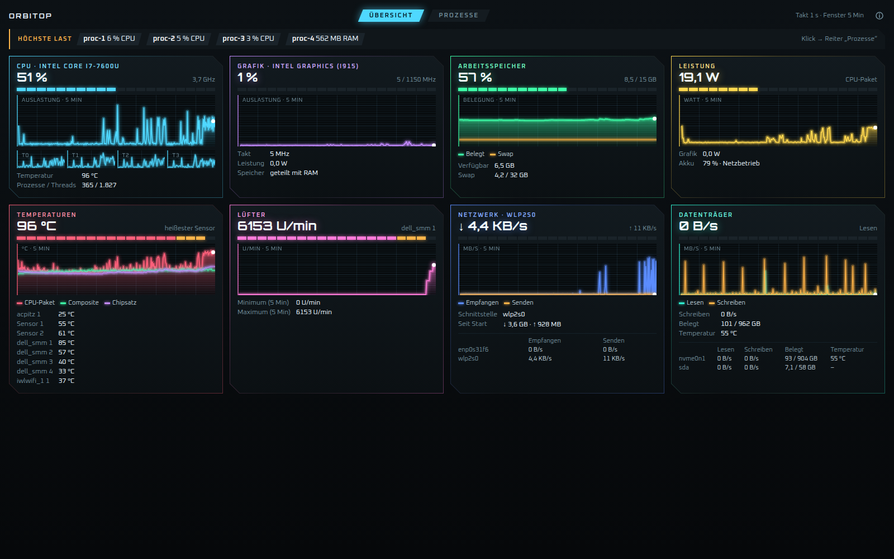
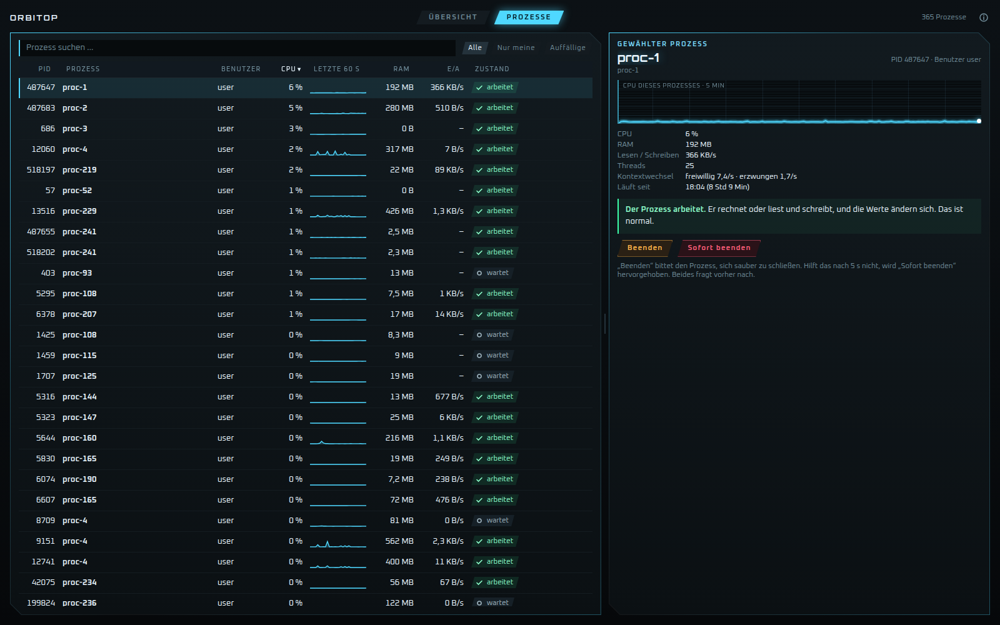

# orbitop

[Deutsch](README.de.md)

A system monitor for Linux that shows what the machine is doing under load, and why.

## What orbitop is for

orbitop shows CPU, GPU, memory, power, temperatures, fans, network and storage as live charts over the last 5 minutes. Its process list tells you which process causes the load and whether that process is working, waiting, busy without any sign of life, or stuck in the kernel. If a process hangs, you can terminate it from the list, always after a confirmation.

orbitop is a GTK 4 window with a WebKitGTK 6.0 view, written in Python with the standard library and PyGObject only. It runs on any hardware: a sensor that is missing is listed as "not available" instead of causing an error. The interface is in English and German and follows the system language.

**Status:** version 0.3.0. orbitop comes as a package for Ubuntu, Debian, Fedora, openSUSE and Arch Linux from its own signed package source. New versions arrive with the regular system update; orbitop itself never goes online.

## Features

### Overview tab

- One tile each for CPU, every GPU, memory, power, temperatures, fans, network and storage, with a chart of the last 5 minutes at one value per second. The CPU tile adds a small chart per thread.
- A strip at the top names the three processes with the highest CPU load and the one with the most RAM. A click on it opens the process tab.
- Sensors the machine does not have are listed at the bottom under "Not available".

### Process tab

- Columns PID, Process, User, CPU, Last 60 s, RAM, I/O and State. The `top` columns PR, NI, VIRT, SHR, S, %MEM and TIME+ are available too and hidden by default.
- A right-click on a column header opens the column menu: show or hide columns, move a column left or right, restore the defaults. On the keyboard, the Menu key or Shift+F10 on a header opens the same menu.
- Drag a header to move the column, drag its right edge to change the width (Alt+Left and Alt+Right on the keyboard). If the columns are wider than the list, the list scrolls sideways.
- A divider between the list and the details can be dragged, or moved with the arrow keys.
- Column order, hidden columns, widths and the divider position are saved in `~/.config/orbitop/layout.json` and survive a restart. If `$XDG_CONFIG_HOME` is set to an absolute path, orbitop uses it instead of `~/.config` for all its files; a relative value is ignored, as the XDG Base Directory Specification asks.
- Search in names and arguments, filters "All", "Mine only" and "Flagged" (every state except working and waiting). A click on a header sorts by that column.
- The details of the selected process show its command line, its CPU history over 5 minutes, RAM, read and write rate, threads, context switches and start time, and for a zombie its parent process.

### Process states are a hint, not a verdict

The process tab classifies each process: working, waiting, constant load, stopped, zombie, stuck in kernel. This is a heuristic from `/proc`, and orbitop says so. "Constant load, no I/O" means at least 90 % of one core for two minutes, at most one voluntary context switch per second and no I/O bytes; from the outside this looks the same as a long computation. "Stuck in kernel" means state D for more than 10 s without progress (no CPU time and no I/O in between). Even "Kill now" only takes effect once the kernel releases such a process.

### Terminating processes

- "Terminate" sends SIGTERM and checks 5 s later whether the process still runs. If it does, "Kill now" (SIGKILL) is highlighted. Both ask for confirmation first.
- Right before the signal, orbitop checks PID and start time again, so a reused PID never hits a different process.
- Your own processes get the signal directly. Processes of other users are terminated only through `pkexec` and the root-owned helper of the package, `/usr/lib/orbitop/killhelper`; polkit asks for the admin password every time. PID 1 and kernel threads cannot be terminated.

Closing the window only hides it. orbitop keeps reading the process list in the background, so the states are already known when you open the window again. Ctrl+Q or "Quit orbitop" in the About dialog ends it. The settings in the About dialog hold the switches "Start at login" (see [Start and autostart](#start-and-autostart)) and "Release counters" (see [Counter release](#counter-release)), and "Show hidden hints again": every hint at the bottom of the window has a "Hide", and a hint about a new situation, such as "not installed" instead of "may not read", appears even after the old one was hidden.

## Screenshots





Both screenshots show demo data from `tests/ui/demo.html`, not a live system. Process names, command lines and users are anonymized; hardware names (CPU, interfaces, disks, sensors) come from the reference laptop. The demo page shows the German interface.

## Installation

orbitop is installed for the whole machine from its own package source on GitHub Pages, `https://zappelmann-sketch.github.io/orbitop/`. A small package from the release sets up this source with its signing key. After that, orbitop and its updates come from the source like any other package. Neither package turns on an autostart or a permission.

### Supported distributions

<!-- supported:start -->
| Checked distribution | Derived from it, not tested |
|---|---|
| Ubuntu 26.04 | |
| Ubuntu 24.04 | Linux Mint 22, Pop!_OS 24.04 |
| Debian 13 | |
| Fedora 45 | |
| Arch Linux | Manjaro, EndeavourOS |
| openSUSE Tumbleweed | |
<!-- supported:end -->

Checked on every release with `scripts/check-distros.sh` in disposable Docker containers: the first installation as below, the test suite, `orbitop --version`, the update to a newer version, uninstall and purge without leftovers, a changed package index, which the package manager must refuse, and the counter release as root: the helper on and off, the package triggers when the Intel GPU tools come or go, the update from 0.2.0, and the removal. The containers have no display and no polkit, so the window itself and the helpers through `pkexec` were not part of the check. Details are in [`docs/distro-check.md`](docs/distro-check.md).

Not supported: Debian 12 (Python 3.11) and Ubuntu 22.04 (Python 3.10). orbitop needs Python 3.12 or newer, so apt refuses to install it there. Derived distributions use the steps of their base. On other distributions, orbitop can run from source (see [Run from source](#run-from-source)); it is not tested there.

### Signing key

The package source and the release files are signed with one key: Ed25519, user ID `orbitop archive signing key`. Its fingerprint:

```text
B6F10E7E76A63D9D569DE0674B5D133F71445C01
```

The fingerprint is in this README and on the page of the package source. The README, the release files and the package source all come from the GitHub account `zappelmann-sketch`, so your first trust in the key rests on that account alone. The steps below use `curl` and GnuPG (`gpg`, on Debian and Ubuntu also `gpgv`). If one is missing, install it: `sudo apt install curl gnupg gpgv`, `sudo dnf install curl gnupg2`, `sudo zypper install curl gpg2 findutils` or `sudo pacman -S curl gnupg`. In a new private directory, download the key in both forms and show it; this installs nothing:

```sh
cd "$(mktemp -d)"
curl -LO https://zappelmann-sketch.github.io/orbitop/orbitop-archive-keyring.asc
curl -LO https://zappelmann-sketch.github.io/orbitop/orbitop-archive-keyring.pgp
gpg --show-keys orbitop-archive-keyring.asc orbitop-archive-keyring.pgp
```

Each file must hold exactly one key: the output shows exactly two keys, one per file, and below each line `pub` exactly the fingerprint above. If it shows more keys or another fingerprint, stop: a file with a second key would let that key sign as well. Run the steps for your distribution in the same terminal, in this directory. On Fedora, openSUSE and Arch the key goes into a keyring of the whole machine (the rpm database, pacman's keyring), which then trusts it for every package source there, not only for this one (apt binds it to this source); the full uninstall ([Uninstall](#uninstall)) removes it again.

### Ubuntu and Debian

Download the package that sets up the source and check it against the signed checksums of the release:

```sh
curl -LO https://github.com/zappelmann-sketch/orbitop/releases/latest/download/orbitop-apt-source.deb
curl -LO https://github.com/zappelmann-sketch/orbitop/releases/latest/download/SHA256SUMS
curl -LO https://github.com/zappelmann-sketch/orbitop/releases/latest/download/SHA256SUMS.asc
gpgv --keyring ./orbitop-archive-keyring.pgp SHA256SUMS.asc SHA256SUMS
sha256sum --ignore-missing -c SHA256SUMS
```

`gpgv` must report `using EDDSA key B6F10E7E76A63D9D569DE0674B5D133F71445C01` with exactly the fingerprint above and `Good signature from "orbitop archive signing key"`, and `sha256sum` must print `orbitop-apt-source.deb: OK`. Then:

```sh
sudo apt install ./orbitop-apt-source.deb
sudo apt update
sudo apt install orbitop
```

`orbitop-apt-source` puts three files under `/etc/apt/`: the source `sources.list.d/orbitop.sources`, its key `keyrings/orbitop-archive-keyring.pgp` and the pinning `preferences.d/orbitop.pref`. `apt policy orbitop` then shows the source with priority 100. If apt notes that the download is performed unsandboxed as root, that is harmless: the user `_apt` cannot read the file in your private directory.

### Fedora

```sh
sudo rpm --import orbitop-archive-keyring.asc
curl -LO https://github.com/zappelmann-sketch/orbitop/releases/latest/download/orbitop-release-fedora.rpm
rpm -K orbitop-release-fedora.rpm
sudo dnf install ./orbitop-release-fedora.rpm
sudo dnf install orbitop
```

`rpm --import` adds the key you checked above. `rpm -K` must print `orbitop-release-fedora.rpm: digests signatures OK`. dnf itself does not check local packages and says that it skipped the OpenPGP checks for one package; `rpm -K` did that check. `orbitop-release` installs the source `/etc/yum.repos.d/orbitop.repo` and its key `/etc/pki/rpm-gpg/RPM-GPG-KEY-orbitop`. On the first use of the source, dnf asks once whether to import this key for the signed package index: compare the fingerprint it shows with the fingerprint above, then answer `y`.

### openSUSE

```sh
sudo rpm --import orbitop-archive-keyring.asc
curl -LO https://github.com/zappelmann-sketch/orbitop/releases/latest/download/orbitop-release-opensuse.rpm
rpm -K orbitop-release-opensuse.rpm
sudo zypper install ./orbitop-release-opensuse.rpm
sudo zypper install orbitop
```

`rpm -K` must print `orbitop-release-opensuse.rpm: digests signatures OK`. Without `rpm --import` first, zypper refuses the package because its key is not available. `orbitop-release` installs the source `/etc/zypp/repos.d/orbitop.repo` and its key. zypper then checks the package index and every package of the source: `zypper lr orbitop` shows `GPG Check` as `(rp) Yes`.

If `run0-wrappers` is installed, it replaces `pkexec` with a wrapper around `run0`, and orbitop cannot terminate other users' processes. Install the package `pkexec` instead with `sudo zypper install pkexec`; zypper offers to replace `run0-wrappers`.

### Arch Linux

Arch has no package for the source; you add it once by hand. On a regular Arch installation, pacman's keyring is set up already. Only if it never was (for example in a fresh container, where `pacman-key --lsign-key` fails), run these two commands first:

```sh
sudo pacman-key --init
sudo pacman-key --populate archlinux
```

Add the key you checked above and sign it locally:

```sh
sudo pacman-key --add orbitop-archive-keyring.asc
sudo pacman-key --lsign-key B6F10E7E76A63D9D569DE0674B5D133F71445C01
```

Then append this section at the very end of `/etc/pacman.conf`, for example with `sudo nano /etc/pacman.conf`:

```ini
[orbitop]
SigLevel = Required DatabaseRequired
Server = https://zappelmann-sketch.github.io/orbitop/arch/$arch
```

The section must come last: if two repositories have a package of the same name, pacman takes it from the one listed first, so a package of the official repositories always wins. pacman checks the signatures of the package database and of every package. Then install orbitop:

```sh
sudo pacman -Syu orbitop
```

On installation, orbitop also adds its key to pacman's keyring (`pacman-key --populate orbitop`), so that a renewed key arrives with an update.

## Updates

New versions of orbitop come with the regular system update:

| Distribution | Command |
|---|---|
| Ubuntu, Debian | `sudo apt update` and `sudo apt upgrade`, or the Software Updater |
| Fedora | `sudo dnf upgrade` |
| openSUSE Tumbleweed | `sudo zypper dup` |
| Arch Linux | `sudo pacman -Syu` |

The source cannot replace packages of your distribution. On Debian and Ubuntu it is pinned to priority 100, dnf and zypper prefer the distribution's repositories (priority 99) over it (priority 100), and on Arch its section comes last. orbitop itself is only in this source, so it is still updated.

### After an Ubuntu release upgrade

An upgrade to a new Ubuntu release turns off every package source that is not Ubuntu's own, this one too: it adds the line `Enabled: no` to `/etc/apt/sources.list.d/orbitop.sources`. The source serves the same suite `stable` to every Ubuntu release, so turn it on again afterwards:

```sh
sudo sed -i '/^Enabled: no$/d' /etc/apt/sources.list.d/orbitop.sources
sudo apt update
```

This restores the file exactly as `orbitop-apt-source` installed it.

## Start and autostart

orbitop is in the application menu, and `orbitop` starts it from a terminal. The packages never set up an autostart.

### For your user

Turn on "Start at login" in the About dialog (the info button in the header). From the next login on, orbitop starts hidden (`--hidden`); starting it from the menu shows the window. The switch does the same as these commands:

```sh
case ${XDG_CONFIG_HOME-} in /*) config=$XDG_CONFIG_HOME ;; *) config=$HOME/.config ;; esac
mkdir -p "$config/autostart"
cp /usr/share/orbitop/autostart.desktop "$config/autostart/io.github.zappelmann_sketch.orbitop.desktop"
```

The first line takes `$XDG_CONFIG_HOME` only if it is an absolute path, as orbitop does. To turn it off, use the switch or remove the file:

```sh
case ${XDG_CONFIG_HOME-} in /*) config=$XDG_CONFIG_HOME ;; *) config=$HOME/.config ;; esac
rm "$config/autostart/io.github.zappelmann_sketch.orbitop.desktop"
```

### For all users

An admin turns the autostart on for every user:

```sh
sudo cp /usr/share/orbitop/autostart.desktop /etc/xdg/autostart/io.github.zappelmann_sketch.orbitop.desktop
```

and off again:

```sh
sudo rm /etc/xdg/autostart/io.github.zappelmann_sketch.orbitop.desktop
```

A user who does not want it turns off the switch. orbitop then writes an entry with `Hidden=true` under the same name into the user's own autostart directory, which takes precedence over the one in `/etc/xdg/autostart/` (freedesktop.org "Desktop Application Autostart Specification"). Removing that file brings the autostart back for this user. The file in `/etc/xdg/autostart/` belongs to the admin, not to the package: it stays after an uninstall, but then starts nothing (`TryExec=orbitop`).

## Graphics and power

orbitop shows every GPU with the values the kernel provides. What else each kind of graphics needs:

### AMD

Nothing. Load, clock, video memory, temperature and power come from the kernel driver `amdgpu`.

### NVIDIA

Load, memory, temperature, power and clock come from `nvidia-smi`, which comes with NVIDIA's proprietary driver (on Ubuntu, for example, through "Additional Drivers"; the command is in `nvidia-utils-<version>`). Without it, orbitop shows a hint instead of the NVIDIA values.

### Intel

Without any tool, orbitop shows the Intel graphics usage of your own processes. The load of all processes and the package power come from `intel_gpu_top` in the Intel GPU tools. The packages only suggest them. On a machine with Intel graphics, the hint "intel_gpu_top is not installed" has a button "Install": it installs the package of your distribution through PackageKit, with the password prompt of the package manager. On Fedora the package manager installs for admins without a password prompt (rule of the distribution). Without the installed package of orbitop, the hint shows the command instead of the button; without PackageKit, or if the installation fails, it shows the command after a click on "Install", and from then on until orbitop restarts. Quitting orbitop cancels a running installation, except on openSUSE, where PackageKit cannot cancel it and it goes on to its end. You can also install them yourself:

| Distribution | Command |
|---|---|
| Ubuntu 26.04 | `sudo apt install igt-gpu-tools` |
| Ubuntu 24.04, Debian 13 | `sudo apt install intel-gpu-tools` |
| Fedora | `sudo dnf install igt-gpu-tools` |
| openSUSE | `sudo zypper install intel-gpu-tools` |
| Arch Linux | `sudo pacman -S intel-gpu-tools` |

The command in the hint names the package that every release of your distribution has: on Debian and Ubuntu `intel-gpu-tools`, which on Ubuntu 26.04 is a metapackage that brings `igt-gpu-tools`.

`intel_gpu_top` reads the counters of all processes only with the counter release below. Without it, orbitop keeps showing your own processes and a hint.

### Counter release

The kernel lets only root read two kinds of counters that orbitop shows: the GPU counters, which `intel_gpu_top` reads with the file capability `cap_perfmon`, and the RAPL energy counters (`/sys/class/powercap/intel-rapl:*`), from which orbitop takes the CPU package power. Without them, the package power comes from `intel_gpu_top` if it has `cap_perfmon`. The switch "Release counters" in the settings of the About dialog (the info button in the header) releases both for every account on the machine and locks them again. It switches only what the machine has: the GPU counters wherever `/usr/bin/intel_gpu_top` is installed, also on a machine without Intel graphics, where the lines below the switch do not show them, and the energy counters where there are RAPL zones (Intel and AMD). The switch is off until an admin turns it on; no installation, update or reinstall turns it on.

Risk: with the switch on, every local account and every sandbox that sees `/sys`, such as a Flatpak app, can read the energy counters, and `intel_gpu_top` runs for every account with `CAP_PERFMON`, so it reads the GPU counters and the package power. The kernel restricts these counters because they allow power side-channel attacks: the Platypus attack (CVE-2020-8694) used them to break KASLR and to recover keys from the kernel and from SGX enclaves. Turn the switch on only if you accept that for every account on the machine.

Before the password, orbitop explains this, and you confirm with "Release". Then polkit asks for the admin password, every time, for "Lock" as well. polkit asks only in a local, active session; in any other session, such as SSH, orbitop shows "Not done – switching works only in a local, active session and with the admin password". An admin in a remote session switches with these commands, the same helper that the switch starts:

```sh
sudo /usr/lib/orbitop/counterhelper on
sudo /usr/lib/orbitop/counterhelper off
```

"On" is a rule for the whole machine, kept in the empty file `/etc/orbitop/counters-released`. What comes later is released as well: when the Intel GPU tools are installed, reinstalled or updated, orbitop's package scripts give the new `intel_gpu_top` the capability, and at boot the udev rule `/usr/lib/udev/rules.d/70-orbitop-counters.rules` makes the energy counters readable. Without that file, neither does anything. "Off" deletes the file first, then takes the capability off `/usr/bin/intel_gpu_top` and makes the energy counters readable only for root again, as the kernel sets them. Afterwards no account can open the counters anew; programs that were already reading, such as an `intel_gpu_top` started while the switch was on or a program that opened an energy counter then, keep their access until they end or the machine restarts. An update of orbitop keeps the switch as it is.

Below the switch, one line per part says whether it is in effect:

- "in effect": released.
- "intel_gpu_top is not installed" or "no energy counters": the switch is on, but the machine lacks this part. It is released as soon as it arrives.
- "not in effect – switch off and on again": the switch is on, but the release is missing, for example after an admin masked the udev rule. Switching off and on applies it again.
- "released by hand": the switch is off, but a capability or a udev rule set by hand releases this part (see [Moving from 0.2.0](#moving-from-020)).
- "not released": the switch is off, and so is the part.

Two results need a closer look. "Not released: unsafe location or environment" means that the helper refused to release, for one of these reasons: `/etc/orbitop` is not a directory of root with the mode `drwx--x--x` (0711) from the package, for example it is readable or writable for other accounts, or a directory above it is not owned by root or is writable for other accounts; `/usr/bin/intel_gpu_top` is not a regular file of root, is writable for other accounts, has more than one hard link, or a directory above it is not owned by root or is writable for other accounts; something other than orbitop's own marker, a regular file of root, lies at `/etc/orbitop/counters-released`; an energy counter `energy_uj` is not a regular file; or orbitop runs in a user namespace such as a rootless container. If `/usr/bin/intel_gpu_top` itself is unsafe, "Off" leaves its capability; `sudo setcap -r /usr/bin/intel_gpu_top` removes it. If `/etc/orbitop` itself is unsafe, for example writable for other accounts or not owned by root, "Off" still takes the capability and the read bits of the energy counters away, but it leaves the marker: at the next boot the udev rule releases the energy counters again, until the directory is fixed. Fix it with `sudo chmod 0711 /etc/orbitop` and `sudo chown root:root /etc/orbitop`, then switch off again. If an admin only made `/etc/orbitop` readable for others, "Off" removes the marker as well; `sudo chmod 0711 /etc/orbitop` restores the mode. "Only partly in effect" means that one part failed with an error of the system, for example on a read-only `/usr` or because `/usr/bin/intel_gpu_top` is a symbolic link; the lines below the switch show which part.

### Without the package

From a checkout without the installed package ([Run from source](#run-from-source)), the switch is locked, and the hints point here. These commands release the counters by hand. The risk is the same as with the switch, and orbitop never runs them on its own. With the package installed, use the switch instead.

The command below gives `/usr/bin/intel_gpu_top` the file capability `cap_perfmon`:

```sh
sudo setcap cap_perfmon=ep /usr/bin/intel_gpu_top
```

`getcap /usr/bin/intel_gpu_top` shows the state. An update of the Intel GPU tools removes the capability; run the command again afterwards. Undo:

```sh
sudo setcap -r /usr/bin/intel_gpu_top
```

This udev rule makes the energy counters readable:

```sh
echo 'ACTION=="add", SUBSYSTEM=="powercap", KERNEL=="intel-rapl:*", RUN+="/usr/bin/chmod 0444 /sys%p/energy_uj"' | sudo tee /etc/udev/rules.d/70-orbitop-rapl.rules
sudo udevadm control --reload
sudo udevadm trigger --subsystem-match=powercap --action=add
```

Undo: remove the rule, then restart the machine.

```sh
sudo rm /etc/udev/rules.d/70-orbitop-rapl.rules
```

### Moving from 0.2.0

The README of 0.2.0 had you set the capability and the udev rule above by hand. The update to 0.3.0 changes neither: it releases nothing, and a capability set by hand stays. orbitop then shows the switch as off and the parts as "released by hand". To let the switch decide, remove both, then turn the switch on:

```sh
sudo rm -f /etc/udev/rules.d/70-orbitop-rapl.rules
sudo setcap -r /usr/bin/intel_gpu_top
```

If `intel_gpu_top` has no capability, `setcap -r` exits with 1 and the message that there is none to remove (`has no capability to remove`, in older versions of libcap `has no capablity to remove`); that is harmless.

Without these commands, turning the switch on and off also takes the capability set by hand away, but the rule stays: the helper never deletes a file that an admin created, and the rule releases the energy counters again at every boot. orbitop then says so below the switch. The package's own rule has another name, so neither rule hides the other.

## Uninstall

First start orbitop from the application menu so that its window appears (an instance started at login may be running hidden), then quit it with Ctrl+Q.

### The counter release on removal

Removing orbitop turns the [counter release](#counter-release) off, on every distribution and already on `remove`, not only on purge: the package runs `counterhelper off`, which deletes `/etc/orbitop/counters-released`, takes the capability off `/usr/bin/intel_gpu_top`, also one set by hand, and makes the energy counters readable only for root. A udev rule of your own under `/etc/udev/rules.d/` stays. Installing orbitop again releases nothing until an admin turns the switch on. On Debian and Ubuntu, deleting the marker on `remove` deviates from Debian Policy 10.7.3, which keeps configuration files until the purge; a marker that stayed would release the counters again on the next installation, without asking the admin (`/usr/share/doc/orbitop/README.Debian`).

If the helper cannot run during the removal, the package manager prints `orbitop: counter release not revoked` (Debian, Ubuntu) or an error of the shell about `/usr/lib/orbitop/counterhelper` (Fedora, openSUSE, Arch). The marker goes all the same, but the capability stays on `intel_gpu_top`, and the energy counters stay readable until the next restart. Then remove the capability and restart the machine:

```sh
sudo setcap -r /usr/bin/intel_gpu_top
```

If `intel_gpu_top` has no capability, `setcap -r` exits with 1 and the message that there is none to remove (`has no capability to remove`, in older versions of libcap `has no capablity to remove`); that is harmless. On a minimal system `setcap` may be missing: it comes with the package `libcap2-bin` on Debian and Ubuntu, `libcap-progs` on openSUSE and `libcap` on Fedora and Arch Linux.

Turn the switch off before a downgrade to 0.2.0. 0.2.0 does not know the marker: it stays after the downgrade, together with the capability on `intel_gpu_top`, and a later update to 0.3.0 releases the counters again without asking. The package source offers no older version.

### Ubuntu and Debian

```sh
sudo apt remove orbitop
```

This removes orbitop and keeps the package source with its key, so `apt update` keeps working and `sudo apt install orbitop` brings orbitop back. The full uninstall also removes the source, its key and the pinning:

```sh
sudo apt purge orbitop orbitop-apt-source
```

### Fedora

```sh
sudo dnf remove orbitop
```

This keeps the source. The full uninstall also removes the source, the key in the rpm database and the copy of the key that dnf keeps for the source:

```sh
sudo dnf remove orbitop-release
rpmkeys --list | grep -F 'orbitop archive signing key' | sed 's/[: ].*//' | xargs -r -n1 sudo rpmkeys --delete
sudo sh -c 'rm -rf /var/cache/libdnf5/orbitop-*'
```

`rpmkeys --list` shows each key of the rpm database with its user ID, on Fedora as its fingerprint in lower case. The second line deletes every key with the user ID `orbitop archive signing key`, also a renewed one that an update brought. The third line runs as root, so that the pattern finds the directories.

### openSUSE

```sh
sudo zypper remove orbitop
```

This keeps the source. The full uninstall also removes the source and the key in the rpm database:

```sh
sudo zypper remove orbitop-release
rpmkeys --list | grep -F 'orbitop archive signing key' | sed 's/[: ].*//' | xargs -r -n1 sudo rpmkeys --delete
```

`rpmkeys --list` shows each key of the rpm database with its user ID, on openSUSE as `<key id>-<date>`, the version and release of its package `gpg-pubkey-<key id>-<date>`. The second line deletes every key with the user ID `orbitop archive signing key`, also a renewed one that an update brought.

### Arch Linux

```sh
sudo pacman -R orbitop
sudo gpg --homedir /etc/pacman.d/gnupg --no-options --no-permission-warning --batch --with-colons --list-keys '=orbitop archive signing key' | awk -F: '$1 == "pub" { p = 1; next } p && $1 == "fpr" { print $10 } { p = 0 }' | grep -xE '[0-9A-F]{40}' | xargs -r -n1 sudo pacman-key --delete
```

The second line removes every key of orbitop from pacman's keyring: each key whose user ID is exactly `orbitop archive signing key`, so the key you added at installation and a renewed one that an update brought. It passes on only the fingerprints of these primary keys; if there is none, nothing runs. Afterwards `pacman-key --list-keys '=orbitop archive signing key'` reports "No public key": none is left. Then delete the section `[orbitop]` (its three lines) from `/etc/pacman.conf` and remove the database of the source, which pacman keeps until `pacman -Sc`. After a prompt, `pacman -Sc` also clears the cached packages that are no longer installed, not only those of orbitop.

```sh
sudo pacman -Sc
```

### Your own files

The packages never touch files in home directories. orbitop keeps the column layout and the hidden hints in `~/.config/orbitop/` and, with the switch "Start at login" on, an autostart entry. To remove them:

```sh
case ${XDG_CONFIG_HOME-} in /*) config=$XDG_CONFIG_HOME ;; *) config=$HOME/.config ;; esac
rm -rf -- "$config/orbitop"
rm -f -- "$config/autostart/io.github.zappelmann_sketch.orbitop.desktop"
```

The first line takes `$XDG_CONFIG_HOME` only if it is an absolute path, as orbitop does.

An autostart for all users is removed as under [For all users](#for-all-users), a release set by hand as under [Moving from 0.2.0](#moving-from-020).

## Moving from 0.1.0

orbitop 0.1.0 ran from an unpacked archive or a checkout. Its setup installed a root helper in `/usr/local/libexec/orbitop/` and, for your user, a launcher, an icon and an autostart entry that point to the directory of the archive or checkout. The package replaces all of them, and the scripts of 0.1.0 are gone, so remove the old files by hand.

First note what you had: the autostart entry, the capability `cap_perfmon` on `intel_gpu_top` and the RAPL rule. Each of these commands shows one of them; an error or no output means it is not there:

```sh
ls ~/.config/autostart/io.github.zappelmann_sketch.orbitop.desktop
getcap /usr/bin/intel_gpu_top
ls /etc/udev/rules.d/70-orbitop-rapl.rules
```

Then quit orbitop 0.1.0 (show its window from the application menu, then Ctrl+Q) and remove its files:

```sh
rm -f ~/.local/share/applications/io.github.zappelmann_sketch.orbitop.desktop
rm -f ~/.local/share/icons/hicolor/scalable/apps/io.github.zappelmann_sketch.orbitop.svg
rm -f ~/.config/autostart/io.github.zappelmann_sketch.orbitop.desktop
sudo rm -r /usr/local/libexec/orbitop
```

The old launcher has the same name as the one of the package and would hide it. The capability `cap_perfmon` and the RAPL rule are the same as in 0.2.0: remove them as under [Moving from 0.2.0](#moving-from-020) and use the switch "Release counters" instead. Afterwards you can delete the directory of 0.1.0.

Then install the package as under [Installation](#installation), and turn on "Start at login" in the About dialog if the autostart was on before. On Ubuntu and Debian, `apt policy orbitop` then shows the package source.

## Run from source

For development, orbitop also runs from a checkout without the package. Install the runtime packages of your distribution from the table below, then:

```sh
git clone https://github.com/zappelmann-sketch/orbitop.git
cd orbitop
bin/orbitop
```

Without the installed package, some things do not work: terminating processes of other users needs the root-owned helper of the package (orbitop shows a hint instead and asks for no password); the switch "Release counters" stays locked, and the hints point to the commands under [Without the package](#without-the-package); the button "Install" is missing, and the hint shows the command instead; and the switch "Start at login" stays locked unless the command `orbitop` is installed. At start, orbitop checks the Python version, PyGObject, GTK 4 and WebKitGTK 6.0. If something is missing, it names the package of your distribution and the command to install it; on an unknown distribution it uses the Debian names. For the tests, see [Tests](#tests).

### Package names

| Distribution | Package manager | Runtime packages | Intel GPU tools |
|---|---|---|---|
| Debian, Ubuntu | `apt-get` | `python3-gi` `gir1.2-gtk-4.0` `gir1.2-webkit-6.0` | `intel-gpu-tools`, Ubuntu 26.04: `igt-gpu-tools` |
| Fedora | `dnf` | `python3-gobject` `gtk4` `webkitgtk6.0` | `igt-gpu-tools` |
| Arch Linux | `pacman` | `python-gobject` `gtk4` `webkitgtk-6.0` | `intel-gpu-tools` |
| openSUSE | `zypper` | `python3-gobject` `typelib-1_0-Gtk-4_0` `typelib-1_0-WebKit-6_0` `python3-gobject-Gdk` | `intel-gpu-tools` |

The packages of orbitop depend on the same runtime packages and on polkit.

## Tech stack

### Language and libraries

- Python 3.12 or newer, standard library only, plus PyGObject for GTK 4 and WebKitGTK 6.0. No psutil: orbitop reads `/proc` and `/sys` itself.
- The interface is HTML, CSS and plain JavaScript in `orbitop/ui/`, without frameworks. `chart.js` draws the charts on a canvas.
- Fonts Orbitron and Oxanium are bundled. All visible texts come from `orbitop/locale/en.json` and `orbitop/locale/de.json`.

### Interface

- A GTK 4 window holds a single WebKitGTK 6.0 view. The page loads from orbitop's own URI scheme `orbitop://ui/`, never from `file://`. The scheme handler serves only regular files of known types below `orbitop/ui/`.
- Content Security Policy: `default-src 'none'`, scripts, styles and fonts only from the page itself, `connect-src 'none'`. The page has no network access.
- The view uses an ephemeral network session and writes nothing to disk. It navigates only to orbitop's own pages; new windows and downloads are refused.
- While the window is visible, Python sends one JSON snapshot per second to `window.orbitop.receive`. Python sends base units; the page formats them with `Intl.NumberFormat`.

### Data sources

- `/proc`: `stat`, `meminfo`, `cpuinfo`, `diskstats`, `net/dev`, `mounts`, and per process `stat`, `status`, `statm`, `io` and `cmdline`.
- `/sys`: CPU frequencies, block devices, network interfaces, thermal zones, batteries, `devfreq` and the DRM cards (GPU load, clock, video memory).
- hwmon (`/sys/class/hwmon`): temperatures, fans and power readings.
- powercap (`/sys/class/powercap/intel-rapl:*`): CPU package power from the RAPL energy counters, if they are readable.
- DRM fdinfo (`/proc/<pid>/fdinfo`): GPU use of your own processes.
- `intel_gpu_top` (optional): Intel GPU load of all processes and the package power.
- `nvidia-smi` (optional): load, memory, temperature, power and clock of NVIDIA GPUs.

### Threads and timing

- `orbitop-worker`: reads the system values every 1 s and builds the snapshot.
- `orbitop-procs`: reads the process list every 2 s, every 4 s while the window is hidden (each value then fills two points of the per-process histories). Reading `/proc/<pid>/cmdline` can block (for example on a hung FUSE or NFS mount); then only the process list waits, the tiles keep running.
- Tools: `intel_gpu_top` and `nvidia-smi` run as long-lived child processes, each read by its own thread. `intel_gpu_top` reports every 2 s, `nvidia-smi` every 1 s.
- Slow hwmon chips (`dell_smm`, where every read is a BIOS call) are read at most every 5 s.
- `/proc/<pid>/status` (owner, context switches) is read every 10 s per process. The selected process and processes at 90 % of one core or more are read on every process tick.
- The GTK main thread only runs the window and the view; the worker hands over the finished JSON through `GLib.idle_add`.

### Security model

- Please report vulnerabilities privately as described in [SECURITY.md](SECURITY.md), not in a public issue.
- The page talks to Python only through `parse_message` in `orbitop/messages.py`. It accepts the messages `ready`, `view`, `layout`, `terminate`, `autostart`, `counters`, `install_tool`, `hide_hint`, `show_hints` and `quit`, checks every value for type and range, drops unknown keys and limits the size to 4096 characters. Anything else is ignored. No message carries a path, a package name or free text; the page gets back only fixed words.
- Process names, command lines and users reach the page only as text (`textContent`), never as HTML.
- orbitop opens no port and makes no network connections. Updates come only through the package manager.
- Terminating a process of another user runs `pkexec /usr/lib/orbitop/killhelper <pid> <start time> <signal>`. The polkit action `io.github.zappelmann-sketch.orbitop.terminate` applies only to this program (`org.freedesktop.policykit.exec.path`) and asks for the admin password every time (`auth_admin`); the dialog shows PID, start time and signal. Before that, orbitop checks with `lstat` that the helper is a regular file and not a symlink, and that it and every directory up to `/` belong to root and are not writable by group or others. If not, it shows a hint and asks for no password. It also starts the helper only through the setuid `pkexec` of polkit: `/usr/bin/pkexec` must be a regular, root-owned ELF program with the setuid bit, in the same kind of directory chain. Otherwise, for example with `run0-wrappers` on openSUSE, terminating other users' processes is not available and orbitop says so.
- The helper opens a pidfd before it checks PID and start time, so the signal reaches exactly the checked process. It refuses PID 1 and kernel threads.
- The switch "Release counters" runs `pkexec /usr/lib/orbitop/counterhelper on` or `off`, after the same checks of the helper and of `pkexec` as above. Each word has its own polkit action, `io.github.zappelmann-sketch.orbitop.counters-release` and `io.github.zappelmann-sketch.orbitop.counters-lock` (`org.freedesktop.policykit.exec.argv1`), with `auth_admin` in a local, active session and `no` in any other. The helper knows only `on`, `off` and `sync`, takes no path and reads no environment, starts no other program, and writes only the marker, the capability on `/usr/bin/intel_gpu_top` and the read bits of `energy_uj` in the zones `intel-rapl:*`. The package scripts call only `sync`, which does nothing without the marker, and `off` on removal; none calls `on`. The design and the remaining risks are in the [security document of 0.3.0](docs/superpowers/specs/2026-11-19-orbitop-0.3.0-security-runde.md) (German).
- One job at a time for "Terminate", "Release counters" and "Install". After a cancelled, refused or unanswered password prompt, terminating a process of another user, "Release counters" and "Install" wait 10 s, after a second one 60 s, after a third until orbitop restarts: they share one count, so even a compromised page gets at most three password prompts. Terminating your own processes needs no password and is never blocked.
- The button "Install" talks to PackageKit 1.x on the system bus through Gio, with the fixed package name of the distribution, only signed packages (`ONLY_TRUSTED`) and a simulation first that may only install or update; it never removes, reinstalls or downgrades a package. Only while the hint "intel_gpu_top is not installed" is shown, and at most one successful installation per run. On apt, `ONLY_TRUSTED` refuses an unsigned package in any case; on dnf and zypper it follows the setting of the repository, and only root can add one that skips the check.
- The switch "Start at login" writes or removes only its own entry in the user's autostart directory, atomically; the page sends only on or off, never a path.
- Hidden hints are kept per user in `~/.config/orbitop/hints.json`, only their keys.
- `intel_gpu_top` and `nvidia-smi` are started with argument lists, never through a shell, and only from the fixed path `/usr/bin:/bin:/usr/local/bin`: the counter release applies only to `/usr/bin/intel_gpu_top`.

### Tests

- pytest. Every reader takes a `root` argument, so the tests run against fake `/proc` and `/sys` trees in `tests/fixtures/roots/`: `intel-laptop` (captured on the reference laptop), `amd-desktop`, `arm-board` and `vm`.
- `tests/ui/check.html` tests the page in headless Chrome at two window sizes. Without Chrome or Chromium these tests skip themselves.
- The suite also runs ShellCheck, `desktop-file-validate` and `appstreamcli`, so it needs pytest, ShellCheck, desktop-file-utils and AppStream.
- `scripts/check-distros.sh` installs, tests, updates and removes the packages from the signed package source in disposable Docker containers, one per distribution. The results are in [`docs/distro-check.md`](docs/distro-check.md). How the packages are built and signed is in [`docs/release.md`](docs/release.md).

```sh
python3 -m pytest -q
```

### Architecture

```text
/proc  /sys  intel_gpu_top  nvidia-smi
   |
   v
sysfs.py  system.py  netdisk.py  sensors.py  gpu.py  gpu_tools.py  procs.py  classify.py
   |
   v
sampler.py tiles.py rates, histories, tiles, JSON snapshot
   |  app.py Worker: threads orbitop-worker (1 s), orbitop-procs (2 s, hidden 4 s)
   v
shell.py            GTK 4 window, WebKitGTK 6.0 view, orbitop://ui/
   |  window.orbitop.receive(msg)
   v
orbitop/ui/js/      page as ES modules from main.js, chart.js draws the charts
   |  postMessage: ready, view, layout, terminate, autostart, counters, install_tool, hide_hint, show_hints, quit
   v
messages.py parse_message
   |-- layout       -> layout.py     -> ~/.config/orbitop/layout.json
   |-- autostart    -> autostart.py  -> ~/.config/autostart/io.github.zappelmann_sketch.orbitop.desktop
   |-- hide_hint    -> hints.py      -> ~/.config/orbitop/hints.json
   |-- terminate    -> jobs.py, gate.py -> actions.py -> own process: signal
   |                                                -> other user: pkexec /usr/lib/orbitop/killhelper
   |-- counters     -> jobs.py, gate.py -> actions.py -> pkexec /usr/lib/orbitop/counterhelper on|off
   '-- install_tool -> jobs.py, gate.py -> packagekit.py -> PackageKit (system bus)
counters.py reads the state of the release without root: marker, capability, mode of energy_uj
```

## Resource use

Measured with `scripts/measure-load.py` on the reference laptop (Intel Core i7-7600U, window 1600×1000, scaling 1.25), over the whole process tree including the WebKit processes and `intel_gpu_top`. Each run took 60 s; "after 1 min" means after 60 s of warm-up, "after 5 min" after five minutes. The window was not touched during the runs: mouse movement over the window makes WebKit draw more frames and raises the load.

| Situation | CPU, % of one core | PSS |
|---|---|---|
| Window hidden | 2.42 to 2.47 | 132 to 134 MB |
| Overview tab | 7.21 to 7.24 | 198 to 201 MB |
| Process tab, default columns | 7.80 to 7.86 | 192 MB |
| Process tab, all 15 columns, after 1 min | 8.74 to 8.81 | 197 to 198 MB |
| Process tab, all 15 columns, after 5 min | 9.41 to 9.60 | 200 to 201 MB |

orbitop's own limits are at most 3 % of one core with the window hidden, at most 9 % with the window visible, and PSS under 275 MB. With the default columns, orbitop stays within them. With all columns shown, the load after 5 minutes is 9.4 to 9.6 %, slightly above 9 %. All columns are only shown on request, so this is an accepted exceedance. About 1 % of one core in every case is `intel_gpu_top`.

## License

GPL-3.0-or-later, see `LICENSE`. Copyright © 2026 zappelmann-sketch.

The bundled fonts Orbitron and Oxanium are licensed under the SIL Open Font License 1.1; the license texts are in `orbitop/ui/fonts/`.
