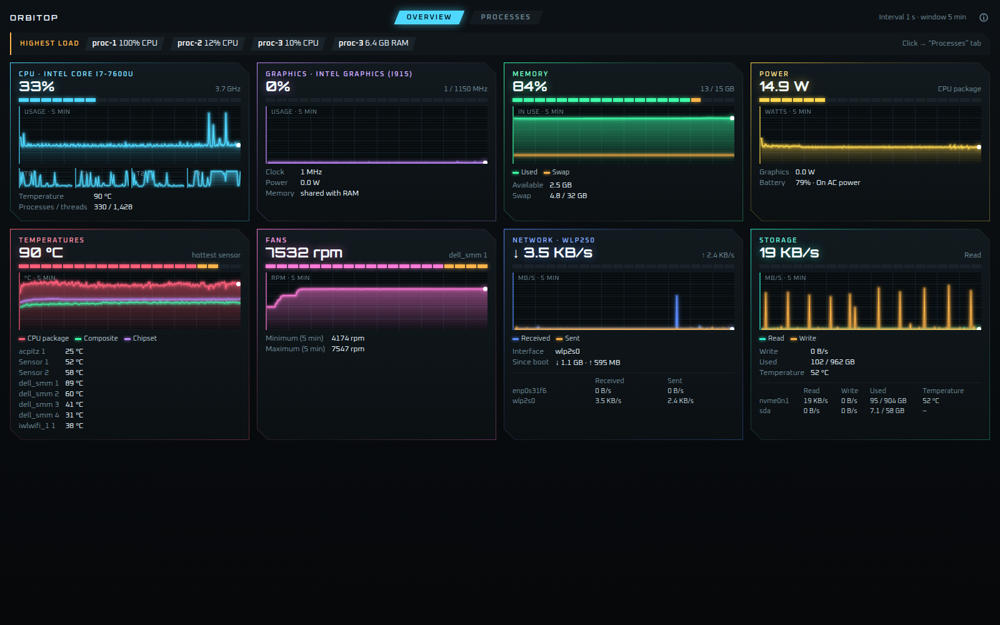

# orbitop

A system monitor for Linux that shows what the machine is doing under load, and why: CPU, GPU, memory, power, temperatures, fans, network and disks as live area charts, plus a process list that tells you which process causes the load and whether it is merely busy or really stuck. If it is stuck, you can terminate it, always after a confirmation.

GTK 4 window with a WebKitGTK 6.0 view, written in Python (stdlib and PyGObject only, no psutil). It runs on any hardware: sensors that are missing are reported as "not available" instead of failing. The interface is available in English and German and follows the system language.



The screenshot shows the overview tab with demo data (`tests/ui/demo.html`), not a live system. Process names, command lines and users are anonymized; hardware names (CPU, interfaces, disks, sensors) come from the reference laptop.

**Status:** stage 1. orbitop is run from a checkout of this repository. There is no `.deb` package and no update channel yet.

## Process states are a hint, not a verdict

The process tab classifies each process (working, waiting, busy without I/O, stopped, zombie, stuck in the kernel). This is a heuristic from `/proc`, and orbitop says so: for example, "busy, no I/O" (at least 90 % of a core for two minutes, almost no voluntary context switches, no I/O bytes) cannot be told apart from a long computation from the outside. "Stuck in the kernel" means state D for more than 10 s without progress (no CPU time and no I/O in between); even "kill now" only takes effect once the kernel releases the process. Before a signal is sent, PID and start time are checked again so a recycled PID is never hit, and processes of other users are terminated only through `pkexec` and the root-owned helper that `setup-privileges.sh` installs.

## Requirements

- Linux, Python 3.12 or newer
- `python3-gi`, `gir1.2-gtk-4.0`, `gir1.2-webkit-6.0` (Ubuntu package names)
- Optional: `intel-gpu-tools` (Intel GPU load of all processes and package power, with `--allow-perfmon`, see below), `nvidia-smi` (NVIDIA GPUs; it ships with the proprietary driver, e.g. in `nvidia-utils-<version>`)

orbitop checks for PyGObject, GTK 4 and WebKitGTK 6.0 at start and names the missing package.

## Install from the repository

```sh
git clone https://github.com/zappelmann-sketch/orbitop.git
cd orbitop
bash scripts/setup-privileges.sh --dry-run        # show what would happen
sudo bash scripts/setup-privileges.sh             # install packages and the root-owned helper
bash scripts/install-user.sh                      # per-user launcher, icon, autostart
```

- `scripts/setup-privileges.sh` (needs `sudo`) installs `gir1.2-webkit-6.0`, and `intel-gpu-tools` if an Intel GPU (i915 or xe) is present. On every machine it copies `orbitop/killhelper.py` root-owned to `/usr/local/libexec/orbitop/killhelper.py`; terminating processes of other users needs this copy. After an update of `orbitop/killhelper.py` in the checkout (for example after `git pull`), run the script again. Only with `--allow-perfmon` does it give `intel_gpu_top` the file capability `cap_perfmon` so it runs without root (see the risks below); upgrading `intel-gpu-tools` removes the capability, so run the script with `--allow-perfmon` again afterwards. `--dry-run` only prints the commands and changes nothing (and needs no root).
- `scripts/install-user.sh` (as your normal user, never root) writes only under `$HOME`: the launcher in `~/.local/share/applications`, the icon, and an autostart entry in `~/.config/autostart` that starts orbitop hidden (`--hidden`) at login. It points at this checkout, so do not move or delete the directory afterwards.

Run it with `bin/orbitop`, or from the application menu after `install-user.sh`.

### Risks of the privileges

- **Root helper `/usr/local/libexec/orbitop/killhelper.py`:** `pkexec` starts it as root once you enter the admin password. The copy in the checkout is never run as root, because any of your processes could change it. Before every call orbitop checks that the helper is a regular file, not a symlink, and that it and every directory up to `/` belong to root and are not writable by group or others. Otherwise it asks for no password and shows a hint to run the setup script. Undo with `sudo rm -r /usr/local/libexec/orbitop`; processes of other users can then no longer be terminated.
- **`--allow-perfmon` (optional, off by default):** sets `cap_perfmon` on `/usr/bin/intel_gpu_top`. Every local account can then run that program with GPU counters and the RAPL package power (CVE-2020-8694). Without the option, orbitop shows only the Intel graphics usage of your own processes. Undo with `sudo setcap -r /usr/bin/intel_gpu_top`.
- **`--allow-rapl` (optional, off by default):** makes the RAPL energy counters readable for all local users (and all Flatpak apps) through a udev rule. The kernel restricts them to root because they enable power side-channel attacks (Platypus, CVE-2020-8694). Without the option, the package power comes from `intel_gpu_top` if it has `cap_perfmon`. Undo with `sudo rm /etc/udev/rules.d/70-orbitop-rapl.rules` and a reboot.

### Uninstall

```sh
bash scripts/install-user.sh --uninstall
```

removes the launcher, icon and autostart entry. The apt packages installed by `setup-privileges.sh` (`gir1.2-webkit-6.0`, `intel-gpu-tools`) stay installed, and so does the helper. The helper and the privileges are undone as described in the risk notes.

## Resource use

Measured on the reference laptop (Dell, Intel Core i7-7600U, 1600x1000 window), over the whole process tree including the WebKit processes and `intel_gpu_top`: about 2.8 % of one core when hidden, 7.8 to 8.3 % with the window open, and at most 264 MB PSS.

## License

GPL-3.0-or-later, see `LICENSE`. Copyright © 2026 zappelmann-sketch.

The bundled fonts Orbitron and Oxanium are licensed under the SIL Open Font License 1.1; the license texts are in `orbitop/ui/fonts/`.

## Kurz auf Deutsch

orbitop ist ein Systemmonitor für Linux (GTK 4 und WebKitGTK 6.0, Python). Er zeigt Verläufe für CPU, GPU, Speicher, Leistung, Temperaturen, Lüfter, Netzwerk und Datenträger und eine Prozessliste, die erklärt, welcher Prozess die Last verursacht. Die Einstufung („hängt“, „Dauerlast“) ist ein Hinweis, kein Urteil. Beenden geschieht nur nach Rückfrage.

Stand: Stufe 1, Start aus dem Repository, noch kein `.deb`-Paket und kein Update-Kanal. Voraussetzungen: `python3-gi`, `gir1.2-gtk-4.0`, `gir1.2-webkit-6.0`, optional `intel-gpu-tools`.

Installation: erst `bash scripts/setup-privileges.sh --dry-run` (zeigt nur an, ohne sudo), dann `sudo bash scripts/setup-privileges.sh`, danach `bash scripts/install-user.sh`. Das Setup-Skript installiert die Pakete und kopiert auf jedem Rechner `orbitop/killhelper.py` root-eigen nach `/usr/local/libexec/orbitop/killhelper.py`. Nach einem Update von `killhelper.py` im Checkout (etwa nach `git pull`) das Skript erneut ausführen. Entfernen mit `bash scripts/install-user.sh --uninstall`; die apt-Pakete (`gir1.2-webkit-6.0`, `intel-gpu-tools`) und der Helfer bleiben installiert.

Risiken:

- **Root-Helfer `/usr/local/libexec/orbitop/killhelper.py`:** `pkexec` startet ihn nach dem Admin-Passwort als root. Die Datei im Checkout läuft nie als root, denn jeder eigene Prozess könnte sie ändern. Vor jedem Aufruf prüft orbitop, dass der Helfer eine reguläre Datei und kein Symlink ist und dass er und jedes Verzeichnis bis `/` root gehören und für Gruppe und andere nicht beschreibbar sind. Sonst fragt es nach keinem Passwort und weist auf das Setup-Skript hin. Rückgängig mit `sudo rm -r /usr/local/libexec/orbitop`; fremde Prozesse lassen sich dann nicht mehr beenden.
- **`--allow-perfmon` (optional, standardmäßig aus):** gibt `/usr/bin/intel_gpu_top` die Fähigkeit `cap_perfmon`. Danach kann jedes lokale Konto damit die GPU-Zähler und die RAPL-Paketleistung lesen (CVE-2020-8694). Ohne die Option zeigt orbitop nur die Auslastung der Intel-Grafik durch eigene Prozesse. Rückgängig mit `sudo setcap -r /usr/bin/intel_gpu_top`.
- **`--allow-rapl` (optional, standardmäßig aus):** macht die RAPL-Energiezähler über eine udev-Regel für alle lokalen Konten lesbar, auch für Flatpak-Apps. Der Kernel sperrt sie für Nicht-Root, weil sie Seitenkanalangriffe auf den Stromverbrauch erlauben (Platypus, CVE-2020-8694). Ohne die Option kommt die Paketleistung von `intel_gpu_top`, wenn es `cap_perfmon` hat. Rückgängig mit `sudo rm /etc/udev/rules.d/70-orbitop-rapl.rules` und einem Neustart.

Lizenz: GPL-3.0-or-later. Die Schriften Orbitron und Oxanium stehen unter der SIL Open Font License 1.1.
